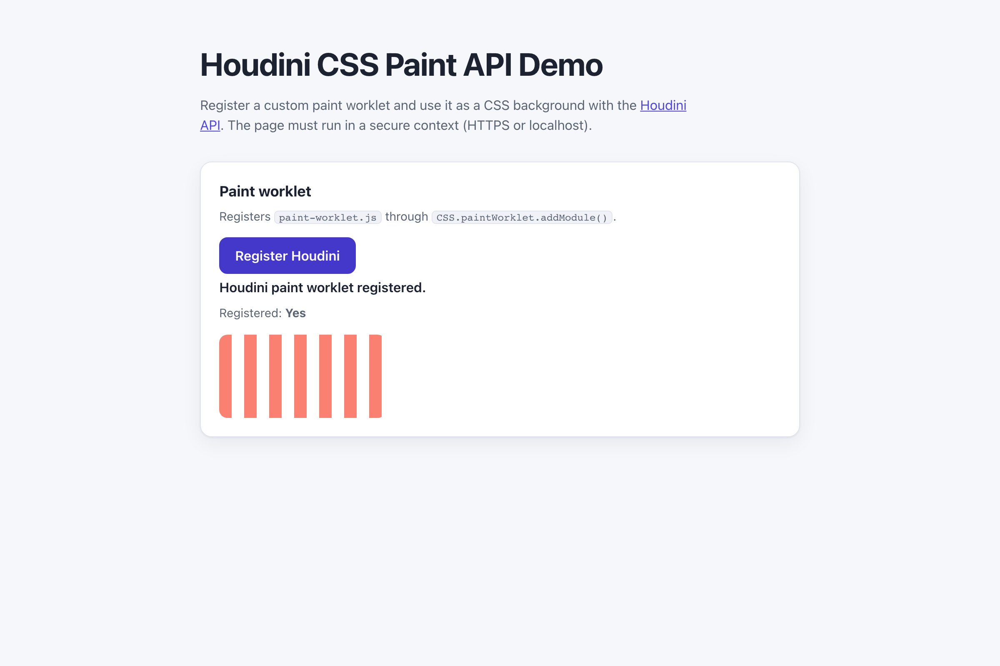

# WebSharper.Houdini

[](https://github.com/dotnet-websharper/HoudiniAPI)

WebSharper bindings for the [Houdini API](https://developer.mozilla.org/en-US/docs/Web/Houdini) —
extending CSS and the rendering engine with custom worklets from F# and C# web apps.

Houdini is an experimental technology. Paint worklets require a secure context (HTTPS or localhost), and some
parts of the API are not available in every browser.

This repository contains:

| Project | Purpose |
| --- | --- |
| `WebSharper.Houdini` | The binding: WIG definitions for `CSS`, `Worklet`, `PaintWorkletGlobalScope`, `StylePropertyMap`, `CSSStyleValue` and its numeric/transform subclasses, and their option dictionaries. |
| `WebSharper.Houdini.Sample` | An ASP.NET Core SPA that registers a striped-background paint worklet and applies it to a CSS box. |

## Live demos

**Try it live:** [Open the sample in your browser](https://dotnet-websharper.github.io/HoudiniAPI/)



The sample doubles as the binding's test case: it registers a paint worklet and renders the striped background in
a real browser.

- **Sample (this repository):** <https://dotnet-websharper.github.io/HoudiniAPI/>
- **Source repository:** <https://github.com/dotnet-websharper/HoudiniAPI>
- **WebSharper bindings:** <https://websharper.com/bindings>

## Features

- `Worklet.addModule()` to load a paint worklet.
- `CSS.registerProperty()` for typed custom properties.
- `PaintWorkletGlobalScope.registerPaint()` for the worklet side.
- `CSSStyleValue` and its `CSSImageValue`, `CSSKeywordValue`, `CSSNumericValue`, `CSSUnitValue`, `CSSMathSum`, `CSSMathProduct`, `CSSUnparsedValue`, `CSSTransformValue`, and `CSSTransformComponent` subclasses.
- `StylePropertyMap` and `StylePropertyMapReadOnly` (`get`, `getAll`, `has`, `set`, `append`, `delete`, `clear`, `entries`, `forEach`, `keys`, `values`).

## Installation

The binding is not currently published to NuGet. Reference the projects from source:

```bash
git clone https://github.com/dotnet-websharper/HoudiniAPI.git
```

```xml
<ItemGroup>
  <ProjectReference Include="path/to/WebSharper.Houdini/WebSharper.Houdini.fsproj" />
</ItemGroup>
```

## Usage

```fsharp
namespace WebSharper.Houdini.Demo

open WebSharper
open WebSharper.JavaScript
open WebSharper.Houdini

[<JavaScript>]
module Demo =
    let registerPaintWorklet () =
        promise {
            let paintWorklet = JS.Window?CSS?paintWorklet |> As<Worklet>
            do! paintWorklet.AddModule("paint-worklet.js") |> Promise.AsAsync
            Console.Log("Paint worklet registered.")
        }
```

The worklet itself is plain JavaScript and calls `registerPaint("striped-background", ...)`. Once registered, the
CSS property `background: paint(striped-background)` paints the element with the worklet's canvas.

## Running the sample

Build the sample in Release and serve its static output:

```bash
dotnet build WebSharper.Houdini.Sample/WebSharper.Houdini.Sample.fsproj -c Release
python3 -m http.server -d WebSharper.Houdini.Sample/wwwroot 8099
```

Open <http://localhost:8099/>. Localhost counts as a secure context, so the paint worklet can be registered. Click
**Register Houdini** and the striped box should appear.

Alternatively, run the ASP.NET Core host:

```bash
dotnet run --project WebSharper.Houdini.Sample
```

## Building from source

### Prerequisites

- [.NET SDK 10](https://dotnet.microsoft.com/download) or later.

### Build

```bash
dotnet build WebSharper.Houdini.sln -c Release
```

The binding projects target `netstandard2.0`; the sample targets `net10.0`.

## Deployment

Pushing to `main` triggers `.github/workflows/ghpages.yml`, which builds the sample in Release and publishes
`WebSharper.Houdini.Sample/wwwroot` to the `gh-pages` branch.

## Repository layout

```
WebSharper.Houdini/              # binding (WIG definitions)
  Main.fs
WebSharper.Houdini.Sample/       # ASP.NET Core SPA demo
  Client.fs
  Startup.fs
  wwwroot/
    index.html
    paint-worklet.js
    site.css
.github/workflows/ghpages.yml    # build + deploy the sample to GitHub Pages
```

## Notes on the API

- **Secure context:** paint worklets are only available in secure contexts. Serve the page over HTTPS or from
  localhost.
- **Experimental:** Houdini is not Baseline. `CSS.paintWorklet`, `CSS.registerProperty`, and the typed CSSOM
  classes are not available in every browser.
- **Worklet files:** the worklet is a separate JavaScript module loaded with `addModule()`. Keep it next to the
  page or point `addModule()` at an absolute URL.
- **Custom properties:** `@property` (or `CSS.registerProperty()`) declares the type and inheritance of a custom
  property so the worklet can read it with `properties.get("--name")`.

## License

Apache 2.0 — see [LICENSE.md](LICENSE.md).
